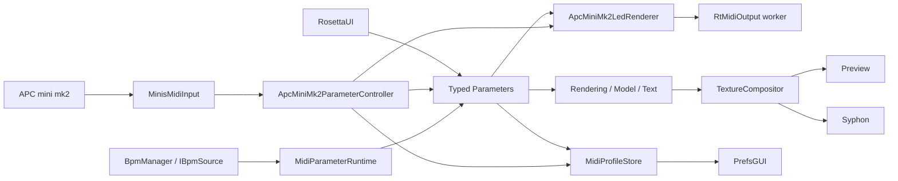
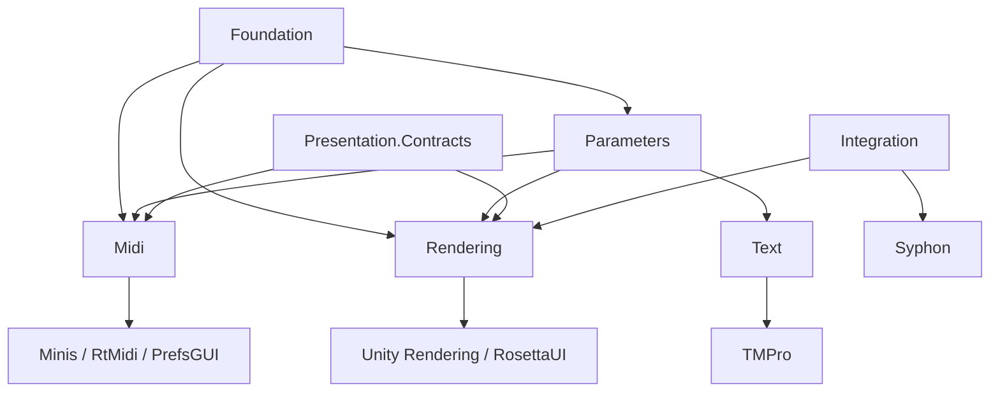

# qoooo Architecture

この文書は qoooo の現行アーキテクチャの入口である。実装の詳細は
[Architecture/](Architecture/) 配下を参照する。

見た目を変更する入口は[CreativeCoding.md](CreativeCoding.md)である。creative workではコード内の
`CREATIVE AREA`、Creative Coding Guide、この文書、詳細文書の順に確認する。

## システム概要

qoooo は、複数の映像sourceを合成し、RosettaUIとAPC mini mk2から操作し、
previewとSyphonへ出力するUnityアプリケーションである。主Sceneは
`Assets/qoooo/Scenes/Trip26.unity` である。

設計の中心は、各機能が所有する型付きParameterである。UIとMIDIは同じParameterを
操作し、描画・Model・Text側はMIDI APIを参照せずParameterの現在値だけを読む。

## 論理領域

| 領域         | 主な責務                                                | 代表パス                            |
| ------------ | ------------------------------------------------------- | ----------------------------------- |
| Foundation   | frame rate、BPM/beat、汎用数学                          | `Assets/qoooo/Scripts/Foundation`   |
| Parameters   | 型付き値、validation、registry、beat/frame更新          | `Assets/qoooo/Scripts/Parameters`   |
| Midi         | raw I/O、APC mapping、Parameter操作、LED、profile       | `Assets/qoooo/Scripts/Midi`         |
| Rendering    | source生成、camera capture、layer effect、合成、preview | `Assets/qoooo/Scripts/Rendering`    |
| Text         | glyph layout、motion、TMP mesh更新                      | `Assets/qoooo/Scripts/Text`         |
| Presentation | RosettaUI構築、Prefs save transaction契約               | `Assets/qoooo/Scripts/Presentation` |
| Integration  | 外部出力。現在はSyphon                                  | `Assets/qoooo/Scripts/Integration`  |
| Editor       | Editor起動時の補助処理                                  | `Assets/qoooo/Scripts/Editor`       |

フォルダとnamespaceは同じ境界を表す。ただしasmdefはなく、すべて
`Assembly-CSharp` / `Assembly-CSharp-Editor` にコンパイルされる。したがって依存方向は
コンパイラではなくinterfaceとレビューで維持している。

## 依存方向

`Presentation.Contracts` は上位UI実装というより、`IUiTarget` と
`IPrefsSaveParticipant` を置く共有境界として使われている。

## 主要な状態所有者

| 状態                                 | 所有者                                          | 備考                               |
| ------------------------------------ | ----------------------------------------------- | ---------------------------------- |
| BPM、経過時間、beat                  | `BpmClock`を持つ`BpmManager`                    | `IBpmSource`でread-only公開        |
| VJ機能の操作値                       | 各consumerがserialized fieldとして持つParameter | Registryはindexでありownerではない |
| APC page、fader mode、pickup、listen | `ApcMiniMk2ParameterController`                 | 保存しないruntime状態              |
| APC mapping                          | `ApcMiniMk2ParameterController`                 | Scene値がdefault、Prefsで上書き    |
| MIDI profile snapshot/dirty          | `MidiProfileStore`                              | mappingと保存対象Parameter値       |
| 描画buffer                           | 各source/cameraと`TextureCompositor`            | 解像度変更時に再生成               |
| Text layout定義                      | `TextController`内の`TextPattern` list          | Trip26ではinactive                  |

## 主要フロー

### 操作

1. RosettaUIはParameterを直接編集するか、APC bindingを変更する。
2. MIDI入力は`MinisMidiInput`でqueueされ、main threadの`Update`でeventになる。
3. `ApcMiniMk2ParameterController`がpageとmappingを解決し、Parameterを更新する。
4. consumerは通常の`Update`でParameter値を読む。
5. `MidiProfileStore`は永続対象の変更をdirtyとして追跡する。

### 描画

1. procedural materialまたはcameraが`ITextureContainer.Texture`を生成する。
2. `TextureLayer`がsourceへeffectを適用する。
3. `TextureCompositor`がscene内のlayer順にping-pong合成する。
4. 最終textureをGame View previewとSyphonへ渡す。

### 時間

`BpmManager`だけが`Time.unscaledDeltaTime`からBPM clockを進める。
`MidiParameterRuntime`はそのbeatからSequenceのactive stepを更新する。
procedural backgroundも同じ`IBpmSource.Beat`をshaderの`_Beat`へ渡す。

## 現行設計上の注意

- `MidiSystemController`はMIDI subsystemのcomposition rootだが、transportやLEDの
  Unity lifecycle自体は各MonoBehaviourも所有する。
- `ApcMiniMk2MidiInput`と文字列keyベースのcontrollerはlegacyコードとして残るが、
  `Trip26` Sceneには配置されていない。
- 現行profileはmapping/stateの2レコードである。connection settingsのPrefs保存、
  独立したSurface/Listen service、orphan state保持は未実装である。
- Legacy Text subsystemはTrip26でinactiveである。内部のglyph motionとtransform animationは
  `Time.time`を使用し、BPM同期ではない。
- EditMode test sourceは2クラスあるが専用asmdefはない。テスト発見可否はUnity Editorで
  確認する必要がある。

## 詳細文書

- [CreativeCoding.md](CreativeCoding.md)
- [Runtime.md](Architecture/Runtime.md)
- [ParametersAndMidi.md](Architecture/ParametersAndMidi.md)
- [RenderingAndText.md](Architecture/RenderingAndText.md)
- [Development.md](Architecture/Development.md)
- [PlanStatus.md](Architecture/PlanStatus.md)
