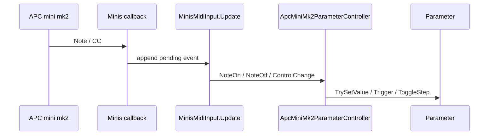

# Parameters and MIDI

## Parameter model

Parameterは各application componentがserialized fieldとして所有する。Registryは値を所有せず、
起動時の初期化、ID検索、一覧化だけを行う。

共通contractは`IMidiBindableParameter`である。

- `Id`: PrefsとBindingで使う、大文字小文字を区別するstable ID
- `DisplayName`: UI表示名。空の場合はIDへfallback
- `Kind`: concrete typeから決まる種別
- `InitializeFromDefault()` / `ResetToDefault()`: Scene defaultからruntime値を作る

| Kind                             | Runtime値                           | APC入力         | 永続化                                 |
| -------------------------------- | ----------------------------------- | --------------- | -------------------------------------- |
| Toggle / `BoolParameter`         | `bool`                              | Padで反転       | 値                                     |
| Radio / `RadioParameter`         | option index                        | optionごとのPad | index                                  |
| State / `StateParameter`         | 循環index                           | Padで次へ       | index                                  |
| Float / `FloatParameter`         | min/max内の`float`                  | Fader           | 値                                     |
| Sequence / `SequenceParameter`   | step pattern、division、active step | stepごとのPad   | patternとdivision。active stepは非保存 |
| Oneshot / `OneshotParameter`     | 押下中の`bool`または1 frame trigger | Note On/Off     | 非保存                                 |
| Momentary / `MomentaryParameter` | 当該frameのflag/count               | Pad trigger     | 非保存                                 |

同値の再設定では通常`Changed`を発火しない。Floatはrangeへclampし、Radioはoption範囲へ
clampする。Sequenceのpattern変更とdivision変更は`Changed`、beatによるactive step変更は
`ActiveStepChanged`として分離されている。

## ProviderとRegistry

Parameterの公開経路は2つある。

- `IMidiParameterContainer`: `ModelController`、`TextController`、`TextureLayer`などのowner
- `IMidiParameterSource`: `MaterialTextureSource`のように`TextureLayer`内へ入れ子になるsource

`TextureLayer`はsourceが`IMidiParameterSource`なら、そのParameterを自身の
`IMidiParameterContainer.MidiParameters`から中継する。

`MidiParameterRegistry.Initialize()`は次を行う。

1. DIされた全containerを列挙する。
2. 空IDとinvalidなRadio/Sequenceを除外する。
3. 重複IDを検出し、そのIDをRegistryから除外する。
4. 有効ParameterをScene defaultで初期化する。
5. `DisplayName`順に並べ、revisionを増やす。

## 現在のParameter owner

| Owner                        | Parameter ID                                                                                   |
| ---------------------------- | ---------------------------------------------------------------------------------------------- |
| procedural background source | `background.pattern`                                                                           |
| model controller             | `model.scale`、`model.motion`、`model.reset-transform`、`model.active`                         |
| model manager                | `model.source`                                                                                 |
| camera pose controller       | `model.camera-pose`                                                                            |
| palette provider             | `visual.palette`                                                                               |
| poster                       | `poster.layout`、`poster.main-text`                                                            |
| rhythm                       | `rhythm.bpm`、`rhythm.tap`、`rhythm.sync-beat`、`rhythm.sync-bar`                              |
| model texture effect         | `effect.model.{uv,sampling,color,alpha,amount,scale,threshold,strength,probability,seed}`      |
| background texture effect    | `effect.background.{uv,sampling,color,alpha,amount,scale,threshold,strength,probability,seed}` |
| legacy text texture effect   | `effect.text.{uv,sampling,color,alpha,amount,scale,threshold,strength,probability,seed}`        |

live Parameterは合計44件である。inactiveなTextLayerのeffect Parameter setも現在のcontainer discoveryから
live Registryへ登録されるため、MIDI Binding UIでは`Text (Legacy)`としてModel / Backgroundと区別する。

Legacy `TextController`の`text.*` Parameterと`poster.model-layout`、`poster.typography-layout`は
Trip26のlive Parameter / MIDI pathからretire済みである。保存済みmappingの該当IDだけはload時に除外し、
それ以外のunknown mappingは保持する。

`poster.layout`のoptionは`PosterLibrary.Documents`の`Name`から起動時とDocument CRUD時に同期する。
option indexとDocument indexは同一で、既存のRadio MIDI mapping形式は変更しない。

`BpmManager`がrhythm Parameterを所有する。`rhythm.bpm`はpending BPMを設定し、実BPMが次beat境界で
変わった時だけ表示値へ同期する。Tap / SyncはOneshot経由で既存`BpmClock`へ渡す。

`KeyboardParameterController`はParameter RegistryからOneshotを解決する。標準mappingはSpace = Tap、
B = Sync Beat、Shift+B = Sync Barであり、UI Toolkitのtext inputがfocus中はkeyboard shortcutを発火しない。

## MIDI input

`MinisMidiInput`はMinis/Input Systemのcallbackをraw eventへ変換する。

- product nameの部分一致とMIDI channelで1台を選ぶ。
- callbackではpending listへ追加し、`Update`でまとめてevent発火する。
- Note On velocity 0はNote Offへ正規化する。
- device change、focus復帰、1秒ごとのscanで再接続する。
- 現実装のpending listはlockで保護されていないため、Minis callbackが別threadになる構成へ
  変更する場合は同期方法を追加する必要がある。

## APC mappingとruntime状態

`ApcMiniMk2ParameterController`が次をまとめて所有する。

- 8 pageのcurrent page
- 型別Binding list
- Pad/FaderからParameterへのindex
- Oneshotの押下中table
- Fader pickup
- Fader buttonのMute/Random mode
- Pad/Fader Listen session

Grid Padだけが通常Binding対象である。Scene Launch 1-8はpage、Track 1-8はFader 1-8 mode、
ShiftはMaster Fader modeに予約される。FaderはCC 48-56を使用する。

Trip26のPage 0 / Row 0 / Column 4は`rhythm.tap`に割り当てる。`rhythm.bpm`はFaderへ割り当てない。

BindingはParameter kindごとのclassに分かれる。Radioはoptionごと、Sequenceはstepごとに
`ApcButtonSlot`を持つ。Floatは0-8のFader indexを持つ。

Listen中に使用済みPad/Faderを割り当てると旧slotをclearして移動する。Fader Listenは最初の
値をbaselineにし、0.05以上動いた時点で確定する。通常Fader操作はtarget値の交差または
0.02以内への進入までpickup待機する。

現実装ではmapping validation、Listen、mode、pickupが単一controllerに統合されている。
独立したSurface/Listen serviceや、競合record全件をinactiveにするresolution modelはまだない。

## MIDI outputとLED

`RtMidiOutput`はRtMidiのopen/send/disposeをbackground threadで行う。

- queue上限は512 message
- port再試行は500ms、接続後のport確認は1秒
- worker wake-upは`AutoResetEvent`、idle waitは最大50ms
- stop時のjoin上限は100ms
- workerのdiagnosticはqueueし、Unity `Debug.Log`はmain threadの`Update`で呼ぶ
- 再接続時は古いqueueを捨て、connection generationを増やす

`ApcMiniMk2LedRenderer`はLateUpdateで最大15Hz描画し、64 Grid、8 Scene、8 Trackと
Shiftの前回値を保持して差分だけ送る。output connection generation変更時は全状態を再送する。

## RosettaUI

`UiBuilder`はownerが公開するParameterを用途別のLive windowへ直接表示する。MIDI UIとLive UIは
同じParameter instanceを参照し、UI専用の値は持たない。

`MidiSystemController`は`IUiTarget`として接続状態、page、profile操作、Mapping UIを公開する。
`MidiBindingUi`はRegistryの型からassignment UIを決め、Parameter値の直接操作は行わない。
Texture effect bindingはstable IDを変えず、Texture Effects → target → UV / Sampling / Color / Alphaへ
表示だけを階層化する。共通Amount / Scale / Threshold / Strength / Probability / Seedはtarget内へまとめる。

`MIDI Setup`は接続概要とReconnectのhubである。詳細は標準RosettaUI child windowへ分ける。

- `MIDI Bindings`: Listen状態、Cancel、scrollableなParameter Bindings
- `MIDI Mapping`: profile状態、Rebuild、Fader button function、Revert、Reset

- Toggle/Oneshot/Momentary/State: 単一PadのListen/Clear
- Radio: optionごとのListen/Clear
- Sequence: stepごとのListen/Clear
- Float: Fader Listen/Clear
- Fader button: Mute/Random functionとRandom division

## Prefs

`MidiProfileStore`はScene上のmappingをdefaultとしてcopyし、互換Prefsがあれば上書きする。

| Key                            | 内容                                         | Schema |
| ------------------------------ | -------------------------------------------- | -----: |
| `qoooo.midi.trip26.mapping.v2` | 型別Binding、Fader function、Random division |      1 |
| `qoooo.midi.trip26.state`      | 保存対象Parameter値                          |      1 |

`ProfileId`は`trip26`固定である。Prefs DTOは`JsonUtility`経由でdeep copyする。

Save buttonの処理は次の順である。

1. 全`IPrefsSaveParticipant.PrepareSave()`
2. `Prefs.Save()`
3. 全`CommitSave()`
4. 例外時は全`AbortSave()`とError log

現行`MidiProfileStore.AbortSave()`はno-opであり、staged Prefs cacheのrollbackは行わない。
`Revert`は起動時または直近Commit時のsnapshot、`Reset Mapping`はScene default、
`Reset Values`はParameter defaultをruntimeへ適用する。ResetはSaveするまで永続化されない。
