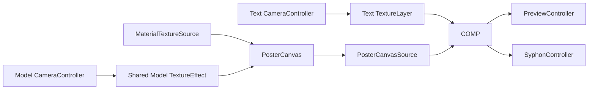

# Rendering and Text

## Texture pipeline

描画系は`ITextureContainer`でtexture sourceを抽象化する。

`TextureLayer`は`MonoBehaviour`参照を持つが、`ITextureContainer`実装だけをsourceとして受け付ける。
任意の`TextureEffect`を適用した後、`TextureCompositor`へ渡す。

ModelとBackgroundの`ProcessedTextureSource`はsourceごとのeffect Parameterを所有する。RosettaUIとMIDIは
同じParameter instanceを編集し、`TextureEffect`が現在値をshader uniformへ渡す。effectは一つのpass内で
次の順に実行する。

1. UV変形
2. Sampling filter
3. Color変換
4. Alpha変換

各段階はmode選択で排他的にし、同じ入力textureを読む複数sampling filterの後勝ちを防ぐ。共有Parameterは
Amount、Scale、Threshold、Strength、Probability、Seedであり、Direction、Grid、Palette colorsは
Texture RosettaUIから編集する。旧Invert / Mosaic / Tiling / Posterize fieldはScene互換のため残し、
段階別effectの前後に従来順で適用する。

Texture RosettaUIは選択中のModel / Backgroundについて、固定順のActive Pipelineをread-only表示する。
effectの選択は既存の4 dropdownだけで行い、任意の並べ替えや複数pass stackは持たない。

Trip26の通常出力では`BackgroundLayer`、`ModelLayer`、`TextLayer`はinactiveであり、
`PosterLayer`だけをCompositorへ渡す。Background generatorとModel CameraはLayerとは独立してactiveである。
`PosterCanvas`はBackground textureを直接参照し、ModelLayerの既存`TextureEffect`を一度だけ適用した
processed Model textureを参照する。

`TextureCompositor`はSceneで設定されたlayer listをBottom-to-Top順に処理し、2枚の
`RenderTexture`をping-pongして合成する。解像度はDIされた`IResolutionContainer`、通常は
`OutputSettings`から取得する。

## Poster composition

`PosterCanvas`は`PosterLibrary.Documents`から選択された`PosterDocument`を描画する。
`PosterDocument = Layout = Preset`であり、別のslotやpreset型は持たない。Documentはfront-to-back順の
`List<PosterElement>`を持ち、Canvas生成時には逆順に生成するため、List先頭が前面になる。
Element typeは`Text`、`Rect`、`Line`、`Texture(Model / Background)`である。各Documentは既定4×6の
point gridを持つ。Grid placementはpoint indexを使い、Width / Heightは正のgrid unitとして保持する。
描画sizeは`Width / Columns`、`Height / Rows`をcanvas幅・高さへ掛け、grid外へ伸びるsizeもclipしない。
Free placementの座標とsizeは従来どおり0..1で保持する。全Elementは共通の9点anchorを持ち、rotationはanchorを中心に
0 / 90 / 180 / 270度で適用する。Textのhorizontal / vertical alignmentはplacement anchorとは別に、
固定placement box内のglyph配置だけを決める。

`poster.layout`はActive PosterDocumentを選択する。

| ID                 | Options                      | 責務                          |
| ------------------ | ---------------------------- | ----------------------------- |
| `poster.layout`    | PosterDocument名の動的list   | Active PosterDocumentの選択   |
| `poster.main-text` | QOOOO / TRIP26 / LIVE VISUAL | Typography Layout内の主役Text |

初期Editorial / Split / Modular / Customは`PosterDocumentFactory`が`Documents`の先頭4件として生成するが、
runtimeで特別なslotとして扱わない。Documentまたは
layout、main text、palette、resolution、source texture参照の変更時に最大1回の全Document rebuildを行う。
`CurrentDate` / `CurrentTime` Text elementは生成したTMP参照を保持し、値が変わった時だけ`TMP.text`を更新する。
`poster.main-text`は`MainText` sourceのText elementから参照する。
`Poster Composer`はDocumentの作成、複製、rename、削除とlayer編集を行うauthoring UIである。
Textは`Poster Font Catalog`のstable IDを保存し、描画とComposer dropdownが同じcatalogを参照する。
IDが空、未知、削除済みの場合はcatalog default、既存`_posterFont`の順でfallbackする。
保存先は`qoooo.poster.library.v3`で、旧v2 pixel/grid recordとv1固定4-field recordはload時に
normalized v3 modelへin-memory migrationする。旧Prefsは変更せず、次の明示Saveでv3を保存する。`poster.model-layout`と
`poster.typography-layout`はretire済みで、live Parameterには登録されない。

## Procedural background

`MaterialTextureSource`は`Custom/ProceduralPattern`用のtexture sourceである。

- `background.pattern`の`RadioParameter`を所有する。
- `IBpmSource.Beat`を毎frame shaderの`_Beat`へ渡す。
- `IResolutionContainer.Resolution`に合わせてoutput textureを再生成する。
- material contractを初回に検査し、property不足時はBlitを行わない。

現在のshader property contract:

| Property                         | Source                          |
| -------------------------------- | ------------------------------- |
| `_PatternType`                   | `background.pattern`のindex 0-9 |
| `_MainColor` / `_SubColor`       | RosettaUI color field           |
| `_Tiling` / `_Offset` / `_Speed` | RosettaUI vector field          |
| `_Opacity`                       | 0-1のUI field                   |
| `_Beat`                          | `IBpmSource.Beat`               |

Pattern IDは現在`MaterialTextureSource.cs`内の`ProceduralPatternType` enum、Radio option、
HLSL dispatcherの対応に依存する。言語間contractを自動検証する専用testはまだない。

## Camera source

`CameraController`はUnity Cameraの`targetTexture`を所有し、出力解像度変更時に
`RenderTexture`を作り直す。ModelとTextは個別cameraで描画され、それぞれの`TextureLayer`へ
渡される。

`CameraPoseController`はcamera poseの操作を担当する。Modelの見た目は
`ModelController`が`model.scale`、`model.motion`、`model.reset-transform`から更新する。
Stillは静止を維持し、Spinは`IBpmSource.Beat`をrotation時間軸に使う。Pulseは同じBeatから
`Rhythm.GetIndex`と`Rhythm.GetPhase`を求め、既存のscale amplitudeでpulseする。

## Text subsystem（Trip26ではinactive）

Legacy Text system（`TextController` / Text Camera / TextLayer）は参照実装として残るが、Trip26最終compositionに含まれない。
SceneではTextControllerとText Cameraをinactiveにし、`text.*` Parameterはlive MIDI pathへ公開しない。

Textはlayoutとmotionを別の責務として扱う。

| 概念              | 型                 | 責務                                                       |
| ----------------- | ------------------ | ---------------------------------------------------------- |
| Layout sampler    | `ITextPattern`     | source文字列からglyph位置・回転・scale・source indexを生成 |
| Layout definition | `TextPattern`      | 名前、基準size、screen coverage、entry listを保持          |
| Entry             | `TextSamplerEntry` | sampler参照、offset/rotation/scale、motion list            |
| Motion            | `TextGlyphMotion`  | sample後の個々のglyphを時間で変形                          |
| Runtime           | `TextController`   | layout選択、sample集約、TMP mesh反映                       |

実装済みlayout:

- `TextCirclePattern`
- `TextGridPattern`
- `TextRectangleLoopPattern`
- `TextCornerRotatePattern`
- `TextTypewriterPattern`

実装済みmotionは`TextRotateMotion`である。

## Legacy Text update flow（Trip26では実行されない）

1. `text.layout`と内部`_patternIndex`を同期する。
2. `text.rebuild`がtriggerされた場合はbase meshを再構築する。
3. `text.transform-mode`からText object全体のtransformを更新する。
4. 選択中`TextPattern`の各entryで`ITextPattern.Sample()`を呼ぶ。
5. 各sampleへentryの`TextGlyphMotion`、offset/rotation/scaleを適用する。
6. camera viewportと`TextPattern.ReferenceSize/ScreenCoverage`からfit scaleを求める。
7. source文字index順に表示文字列を作り、TMP vertexへTRSを適用する。

次のfieldはLegacy Text内部のserialized stateとしてコードに残るが、Trip26ではinactiveであり、
live Parameter Registry、MIDI mapping、Prefs stateには含まれない。

| ID                     | 用途                           |
| ---------------------- | ------------------------------ |
| `text.layout`          | layout選択                     |
| `text.animation-speed` | motion時間倍率                 |
| `text.transform-mode`  | object全体の静止/移動/回転mode |
| `text.rebuild`         | mesh再構築trigger              |
| `text.blink`           | beat sequenceによる表示ON/OFF  |

layout optionは`Awake`/`OnValidate`で`TextPattern.Name`から同期される。

## Output

- `PreviewController`は合成textureをScene内の`RawImage`へ表示する。
- `SyphonController`は同じ合成textureをKlak.Syphonの`SyphonServer`へ設定する。
- Syphon server名は`PrefsString`で保存される。

## Resource lifecycle

procedural source、camera source、compositorは必要な解像度の`RenderTexture`を遅延生成する。
所有者がdisable/destroyされた場合は`Release()`してからUnity objectを破棄する。
