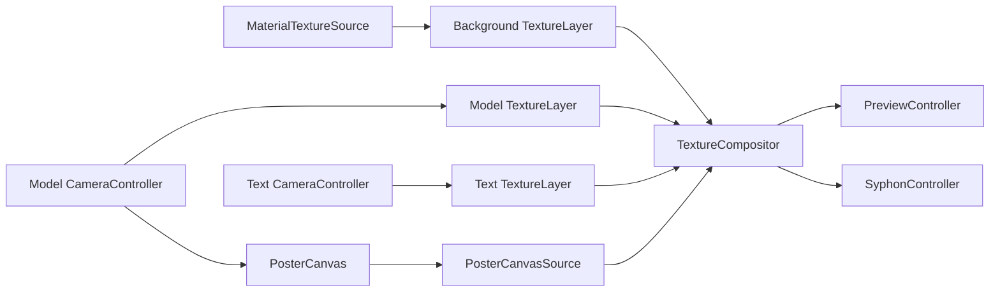

# Rendering and Text

## Texture pipeline

描画系は`ITextureContainer`でtexture sourceを抽象化する。

`TextureLayer`は`MonoBehaviour`参照を持つが、`ITextureContainer`実装だけをsourceとして受け付ける。
任意の`TextureEffect`を適用した後、`TextureCompositor`へ渡す。

`TextureCompositor`はSceneで設定されたlayer listをBottom-to-Top順に処理し、2枚の
`RenderTexture`をping-pongして合成する。解像度はDIされた`IResolutionContainer`、通常は
`OutputSettings`から取得する。

## Poster composition

`PosterCanvas`はModel Cameraの1枚のRenderTextureを複数の`RawImage`として再利用する。
Posterの操作軸は次の3つである。

| ID                           | Options                                      | 責務                                      |
| ---------------------------- | -------------------------------------------- | ----------------------------------------- |
| `poster.layout`              | Editorial / Split / Modular / Custom         | 下記2軸を同時設定する互換Safe Preset      |
| `poster.model-layout`        | Hero / Split / Repeat                        | Model RenderTextureの数、位置、crop、回転 |
| `poster.typography-layout`   | Poster Copy / Headline / Labels              | TextとRect、Line、Band等のsupport graphics |
| `poster.main-text`           | QOOOO / TRIP26 / LIVE VISUAL                 | Typography Layout内の主役Text             |

Editorial、Split、Modularは同じindexのModel LayoutとTypography Layoutを適用する。
いずれかの独立軸を直接変更すると`poster.layout`はCustomになる。2軸の一方が変化した時だけ、
既存要素をclearし、Model、Typographyの順でPoster UIを再構築する。Typography側は全面を覆う
不透明Rectを生成せず、下層の`background.pattern`と共存する。`poster.main-text`はSafe Preset
に含めず、変更時はPosterを再構築する。

## Procedural background

`MaterialTextureSource`は`Custom/ProceduralPattern`用のtexture sourceである。

- `background.pattern`の`RadioParameter`を所有する。
- `IBpmSource.Beat`を毎frame shaderの`_Beat`へ渡す。
- `IResolutionContainer.Resolution`に合わせてoutput textureを再生成する。
- material contractを初回に検査し、property不足時はBlitを行わない。

現在のshader property contract:

| Property                         | Source                          |
| -------------------------------- | ------------------------------- |
| `_PatternType`                   | `background.pattern`のindex 0-9 |
| `_MainColor` / `_SubColor`       | RosettaUI color field           |
| `_Tiling` / `_Offset` / `_Speed` | RosettaUI vector field          |
| `_Opacity`                       | 0-1のUI field                   |
| `_Beat`                          | `IBpmSource.Beat`               |

Pattern IDは現在`MaterialTextureSource.cs`内の`ProceduralPatternType` enum、Radio option、
HLSL dispatcherの対応に依存する。言語間contractを自動検証する専用testはまだない。

## Camera source

`CameraController`はUnity Cameraの`targetTexture`を所有し、出力解像度変更時に
`RenderTexture`を作り直す。ModelとTextは個別cameraで描画され、それぞれの`TextureLayer`へ
渡される。

`CameraPoseController`はcamera poseの操作を担当する。Modelの見た目は
`ModelController`が`model.scale`、`model.motion`、`model.reset-transform`から更新する。

## Text model

Textはlayoutとmotionを別の責務として扱う。

| 概念              | 型                 | 責務                                                       |
| ----------------- | ------------------ | ---------------------------------------------------------- |
| Layout sampler    | `ITextPattern`     | source文字列からglyph位置・回転・scale・source indexを生成 |
| Layout definition | `TextPattern`      | 名前、基準size、screen coverage、entry listを保持          |
| Entry             | `TextSamplerEntry` | sampler参照、offset/rotation/scale、motion list            |
| Motion            | `TextGlyphMotion`  | sample後の個々のglyphを時間で変形                          |
| Runtime           | `TextController`   | layout選択、sample集約、TMP mesh反映                       |

実装済みlayout:

- `TextCirclePattern`
- `TextGridPattern`
- `TextRectangleLoopPattern`
- `TextCornerRotatePattern`
- `TextTypewriterPattern`

実装済みmotionは`TextRotateMotion`である。

## Text update flow

1. `text.layout`と内部`_patternIndex`を同期する。
2. `text.rebuild`がtriggerされた場合はbase meshを再構築する。
3. `text.transform-mode`からText object全体のtransformを更新する。
4. 選択中`TextPattern`の各entryで`ITextPattern.Sample()`を呼ぶ。
5. 各sampleへentryの`TextGlyphMotion`、offset/rotation/scaleを適用する。
6. camera viewportと`TextPattern.ReferenceSize/ScreenCoverage`からfit scaleを求める。
7. source文字index順に表示文字列を作り、TMP vertexへTRSを適用する。

Textが所有するParameter:

| ID                     | 用途                           |
| ---------------------- | ------------------------------ |
| `text.layout`          | layout選択                     |
| `text.animation-speed` | motion時間倍率                 |
| `text.transform-mode`  | object全体の静止/移動/回転mode |
| `text.rebuild`         | mesh再構築trigger              |
| `text.blink`           | beat sequenceによる表示ON/OFF  |

layout optionは`Awake`/`OnValidate`で`TextPattern.Name`から同期される。
同名optionの検証やprofile schema migrationは現状実装されていないため、保存済みindexがある状態で
Sceneのlayout順を変える場合は互換性を確認する。

## Output

- `PreviewController`は合成textureをScene内の`RawImage`へ表示する。
- `SyphonController`は同じ合成textureをKlak.Syphonの`SyphonServer`へ設定する。
- Syphon server名は`PrefsString`で保存される。

## Resource lifecycle

procedural source、camera source、compositorは必要な解像度の`RenderTexture`を遅延生成する。
所有者がdisable/destroyされた場合は`Release()`してからUnity objectを破棄する。
