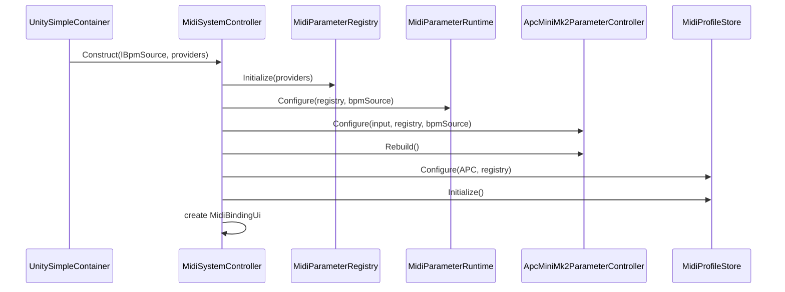

# Runtime Composition and Lifecycle

## Composition root

主Sceneは `Assets/qoooo/Scenes/Trip26.unity` である。Sceneには次の論理グループがある。

- `Managers`: frame rateやアプリ全体のmanager
- `MIDI`: BPM、Parameter registry/runtime、MIDI input/output、APC controller、LED、profile
- `Sources`: procedural backgroundやcamera由来のtexture source
- `Layers`: Background / Model / Text / Posterの`TextureLayer`
- `TextureCompositor`: layerの最終合成
- `UiBuilder`: RosettaUIのwindow構築
- `PreviewCanvas`: 合成結果のGame View表示
- `SyphonController`: 合成結果の外部publish

`Trip26`の`MIDI` GameObjectには少なくとも次が配置されている。

- `BpmManager`
- `MidiSystemController`
- `ApcMiniMk2ParameterController`
- `MinisMidiInput`
- `MidiParameterRuntime`
- `MidiParameterRegistry`
- `MidiProfileStore`
- `ApcMiniMk2LedRenderer`
- `RtMidiOutput`

旧`ApcMiniMk2MidiInput`はソースには残るが、このSceneには配置されていない。

## DIとserialized reference

UnitySimpleContainerはScene componentが実装するinterfaceを収集し、`[Inject]` methodへ渡す。
主な注入は次の通りである。

| Consumer                      | 注入されるcontract                                             |
| ----------------------------- | -------------------------------------------------------------- |
| `MidiSystemController`        | `IBpmSource`、`IEnumerable<IMidiParameterContainer>`           |
| `UiBuilder`                   | `IEnumerable<IUiTarget>`、`IEnumerable<IPrefsSaveParticipant>` |
| `MaterialTextureSource`       | `IResolutionContainer`、`IBpmSource`                           |
| `TextureCompositor`           | `IResolutionContainer`                                         |
| `CameraController`            | `IResolutionContainer`                                         |
| `ModelController`             | `IBpmSource`                                                   |
| `KeyboardParameterController` | `MidiParameterRegistry`（serialized reference）                |

MIDI内部componentはconcrete typeをDI解決せず、`MidiSystemController`のserialized referenceで
明示的に接続する。このためScene上の参照がMIDI subsystemの構成定義になる。

## MIDI初期化

`MidiSystemController.Initialize()`は`Awake`と`OnEnable`から呼ばれ、さらにDI完了後の
`Construct`から必要に応じて再試行される。`_initialized`で多重初期化を防ぐ。

必須参照か`IBpmSource`が欠ける場合、MIDI subsystemは初期化せずErrorを出す。
Parameter owner、Rendering、Text自体はMIDI接続の有無に依存しない。

## フレーム実行順

|      Order | Component                       | 処理                                                   |
| ---------: | ------------------------------- | ------------------------------------------------------ |
|     -10000 | `FrameRateController`           | target frame rate設定                                  |
|      -9000 | `MidiSystemController`          | compositionの初期化                                    |
|       -120 | `BpmManager`                    | unscaled timeでclock更新                               |
|       -110 | `MidiParameterRuntime`          | Momentary reset、Oneshot遅延release、Sequence step更新 |
|       -100 | `MinisMidiInput`                | device scan、queued raw event dispatch                 |
|       -100 | `MaterialTextureSource`         | uniform設定とprocedural texture生成                    |
|        -90 | `ApcMiniMk2ParameterController` | fader Randomのbeat境界更新                             |
|        -80 | `KeyboardParameterController`   | UI focus外のkeyboard shortcutをOneshotへ変換           |
|          0 | Rendering / Model / Text        | Parameterを読み、frameの見た目を更新                   |
| LateUpdate | `ApcMiniMk2LedRenderer`         | 15Hzを上限にLED差分送信                                |

`MinisMidiInput`のeventはdispatch時に同期的にAPC controllerへ届くため、通常orderのconsumerは
同じframeで更新済みParameterを読む。

`BpmManager`は`BpmClock`を`Time.unscaledDeltaTime`で更新する唯一のownerである。
`Rhythm`はbeatをvisual phase/index/noiseへ変換するutilityであり、clock stateを持たない。

## Runtime UI

`UiBuilder`は既存Parameter ownerから同じParameter instanceを収集し、用途別のlauncherを構築する。

- `LIVE CONTROLS`: Model、Camera、Poster、Background / Palette、Rhythm、Effects
- `AUTHORING TOOLS`: Poster Composer
- `SETUP / DEBUG`: Output Setup、MIDI Setup

Live UIはTyped Parameterを直接操作し、Poster Composerは`PosterLibrary`を編集する。MIDI Setup内の
hubは接続状態とReconnectだけを扱い、標準`WindowLauncher`で`MIDI Bindings`（APC assignment）と
`MIDI Mapping`（profile、rebuild、reset）を子Windowとして開く。Saveはroot windowに残る。

Saveは明示操作であり、Play停止時には自動実行されない。`UiBuilder`が全`IPrefsSaveParticipant`の
`PrepareSave`、`Prefs.Save`、`CommitSave`を順に実行し、例外時は`AbortSave`を呼ぶ。

## Enable / Disable

- `MinisMidiInput`はenable時にInput System device changeを購読し、disable時に解除する。
- `ApcMiniMk2ParameterController`はinput eventを重複購読しないよう解除後に再購読する。
- `RtMidiOutput`はenable時にbackground workerを開始し、disable時に100ms上限で停止を待つ。
- `ApcMiniMk2LedRenderer`はdisable/destroy時に全LED消灯をqueueする。
- `MidiSystemController`もdisable/destroy時にLED clearとoutput stopを一度だけ実行する。
- source/compositor/cameraは所有する`RenderTexture`をdisableまたはdestroyで解放する。

## Sceneを変更するときの規則

1. Parameter ownerは`IMidiParameterContainer`を実装する。
2. nested sourceのParameterは`IMidiParameterSource`として`TextureLayer`から公開する。
3. UIへ出すcomponentは`IUiTarget`を実装する。
4. MIDI内部の必須component参照は`MidiSystemController` Inspectorへ設定する。
5. script移動時は`.meta`を同時に移動し、Scene参照のGUIDを維持する。
